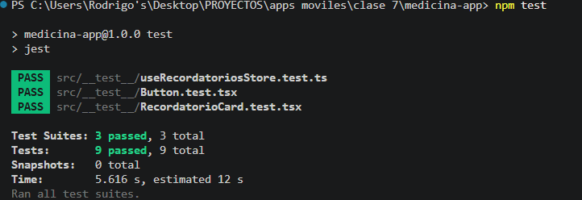

# Medicina App 🩺💊

**Medicina App** es una aplicación móvil desarrollada con **React Native**, **Expo SDK 58** y **TypeScript**, diseñada para gestionar medicamentos y recordatorios de tomas de forma intuitiva, offline-first e integrada con los recursos nativos del dispositivo (cámara, galería, ubicación GPS, contactos, calendario y notificaciones locales).

---

## 📸 Captura de Pantalla - Tests Completados



## 📹 Video de Presentación

[Video DEMO](https://drive.google.com/file/d/1RayS-wPBdhQmS3mv3oyfxO53Sl3mJ0Bn/view?usp=sharing)

---

## 📂 Estructura del Proyecto

```text
medicina-app/
├── App.tsx                          # Punto de entrada principal de la aplicación
├── app.json                         # Configuración de Expo, permisos y plugins
├── jest.config.js                   # Configuración de Jest y preset de React Native
├── jest.setup.js                    # Mocks globales para AsyncStorage y módulos nativos
├── package.json                     # Dependencias y scripts del proyecto
└── src/
    ├── __test__/                    # Suite de pruebas unitarias y de componentes
    │   ├── useRecordatoriosStore.test.ts
    │   ├── Button.test.tsx
    │   └── RecordatorioCard.test.tsx
    ├── components/                  # Componentes de interfaz
    │   ├── ui/                      # Componentes atómicos reutilizables (Button, StatusChip, etc.)
    │   ├── ModalAgregarRecordatorio.tsx
    │   └── RecordatorioCard.tsx
    ├── context/                     # Proveedores de estado de sesión
    │   └── AuthContext.tsx
    ├── hooks/                       # Hooks personalizados para APIs nativas
    │   ├── useCalendar.ts           # Permisos y creación de eventos en calendario
    │   ├── useContacts.ts           # Selector de contactos del dispositivo
    │   ├── useLocation.ts           # Obtención de coordenadas GPS y dirección
    │   └── useMediaPicker.ts        # Acceso a cámara y galería de imágenes
    ├── navigation/                  # Configuración de React Navigation (Bottom Tabs)
    ├── screens/                     # Pantallas principales (Inicio, Perfil)
    ├── services/                    # Servicios auxiliares y notificaciones
    ├── store/                       # Estado global con Zustand + persistencia
    │   └── useRecordatoriosStore.ts
    ├── theme.ts                     # Paleta de colores, espaciados y tipografía
    └── types.ts                     # Interfaces y tipos TypeScript
```

---

## 🚀 Funcionalidades Principales

* **Gestión de Recordatorios:** Crear, listar, marcar como completados y eliminar recordatorios con dosis (pastillas o ml) y tiempos predefinidos o personalizados.
* **Estado Global y Persistencia Offline:** Gestión reactiva mediante **Zustand** sincronizada automáticamente con **AsyncStorage**.
* **Integración con Recursos Nativos y Gestión de Permisos:**
  * **📷 Cámara y Galería (`expo-image-picker`):** Permite fotografiar el medicamento o seleccionarlo desde la galería con previsualización en la tarjeta.
  * **📍 Geolocalización GPS (`expo-location`):** Adjunta la ubicación y dirección de la farmacia más cercana al recordatorio.
  * **👤 Agenda de Contactos (`expo-contacts/legacy`):** Permite vincular un médico o familiar de contacto al tratamiento.
  * **📅 Calendario Nativo (`expo-calendar/legacy`):** Solicita permisos dinámicamente al activar el interruptor (*Switch*) en el formulario y agenda el evento con alarma en el calendario del teléfono.
  * **🔔 Notificaciones Locales (`expo-notifications`):** Programa y cancela alertas locales en el horario exacto de cada toma.
* **Pruebas Unitarias y de Renderizado:** Cobertura automatizada sobre el store de Zustand y los componentes críticos de UI.

---

## 📱 Pantallas y Navegación

La aplicación utiliza **React Navigation (Bottom Tabs)** para estructurar la navegación:

1. **Pantalla Principal (Inicio / Recordatorios):**
   * Muestra el listado de medicamentos programados mediante `RecordatorioCard` con indicadores de estado (`Pendiente`, `Enviado`, `Completado`, `Expirado`) y metadatos nativos adjuntos.
2. **Modal de Nuevo Recordatorio (`ModalAgregarRecordatorio`):**
   * Formulario interactivo con selector de dosis, botones de recursos nativos (Cámara, Galería, Ubicación, Contactos), *Switch* con solicitud de permiso de calendario y cálculo en tiempo real de la hora de notificación.
3. **Pantalla de Perfil de Usuario:**
   * Muestra los datos del perfil gestionados mediante `AuthContext`.

---

## 💾 Estado Global y Persistencia (Zustand + AsyncStorage)

La gestión de recordatorios se centraliza en `useRecordatoriosStore.ts` utilizando el middleware `persist` de **Zustand** conectado a **`@react-native-async-storage/async-storage`**:

* **Clave de almacenamiento:** `@notifications_recordatorios`
* **Acciones principales:** `agregarRecordatorioStore`, `completarRecordatorioStore`, `eliminarRecordatorioStore`, `actualizarRecordatorioStore` y `verificarExpirados`.

---

## 🛠️ Requisitos Previos e Instalación

Asegúrate de contar con **Node.js (v18+)** y la app **Expo Go** instalada en tu dispositivo móvil.

1. **Clonar el repositorio e instalar dependencias:**
   ```bash
   npm install --legacy-peer-deps
   ```

---

## 📱 Cómo Iniciar el Proyecto con Expo Go

Para levantar el servidor de desarrollo en modo Expo Go y limpiar la caché:

```bash
npx expo start --go -c
```

Escaneá el código QR generado en la terminal desde **Expo Go** (Android) o la app **Cámara** (iOS).

---

## 🧪 Ejecución de Pruebas Unitarias (Jest)

El proyecto cuenta con pruebas automatizadas implementadas con **Jest** y **React Native Testing Library**.

### Correr toda la suite de pruebas:
```bash
npm test
```

### Correr pruebas individuales:
* **Pruebas del Store de Zustand (`useRecordatoriosStore`):**
  ```bash
  npm run test:store
  ```
* **Pruebas del componente `Button`:**
  ```bash
  npm run test:button
  ```
* **Pruebas de la tarjeta `RecordatorioCard`:**
  ```bash
  npm run test:card
  ```

---

## 🛠️ Tecnologías Utilizadas

* **Framework:** React Native (0.88) / Expo SDK 58 (React 19)
* **Lenguaje:** TypeScript
* **Estado Global y Persistencia:** Zustand v5 + `@react-native-async-storage/async-storage`
* **APIs Nativas:** `expo-image-picker`, `expo-location`, `expo-contacts`, `expo-calendar`, `expo-notifications`
* **Navegación:** `@react-navigation/native` + `@react-navigation/bottom-tabs`
* **Fechas:** `date-fns`
* **Testing:** Jest + `jest-expo` + `@react-native/jest-preset` + `@testing-library/react-native`