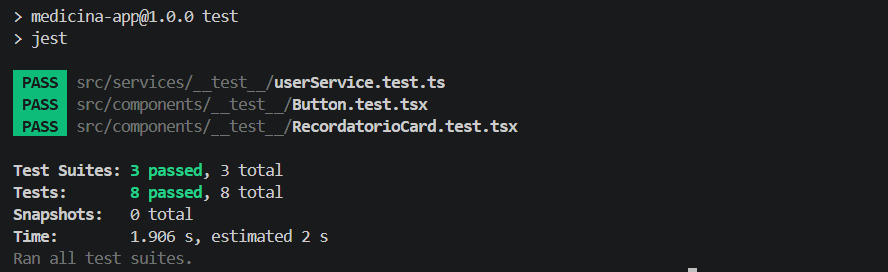

# Medicina App 🩺💊

**Medicina App** es una aplicación móvil desarrollada con **React Native** y **Expo** diseñada para ayudar a los usuarios a gestionar sus medicamentos, recordatorios de tomas y perfiles médicos de forma intuitiva, rápida y offline-first.

---

## 📸 Captura de Pantalla - Tests Completados




## 📹 Video de Presentacion

[Video DEMO](https://drive.google.com/file/d/1JzoddT4N3ELqcx4GlxiTYC2WCDaRPkMO/view?usp=sharing)

---

## 📂 Estructura del Proyecto

```text
medicina-app/
├── App.tsx                          # Punto de entrada principal de la aplicación
├── app.json                         # Configuración de Expo y plugins
├── jest.config.js                   # Configuración de Jest para ejecuciones de prueba
├── package.json                     # Dependencias y scripts del proyecto
└── src/
    ├── components/                  # Componentes de la interfaz
    │   ├── __test__/                # Pruebas unitarias de componentes (Button, RecordatorioCard)
    │   ├── ui/                      # Componentes atómicos/reutilizables (Button, Input, etc.)
    │   ├── ModalAgregarRecordatorio.tsx
    │   └── RecordatorioCard.tsx
    ├── context/                     # Proveedores de estado global
    │   └── AuthContext.tsx          # Contexto de autenticación y estado del usuario
    ├── hooks/                       # Hooks personalizados
    ├── navigation/                  # Configuración de React Navigation (Tabs, Stacks)
    ├── screens/                     # Pantallas principales (Inicio, Formulario, Perfil)
    ├── services/                    # Lógica de negocio y persistencia
    │   ├── __test__/                # Pruebas unitarias de servicios (userService.test.ts)
    │   └── userService.ts           # Servicio para gestión de usuario y datos
    ├── theme.ts                     # Definiciones de colores, tipografía y estilos globales
    └── types.ts                     # Definiciones de tipos e interfaces TypeScript
```

---

## 🚀 Funcionalidades Principales

* **Gestión de Recordatorios:** Crear, listar, marcar como completados y eliminar recordatorios de medicamentos.
* **Persistencia de Datos Offline:** Guardado local seguro para asegurar que la información no se pierda al cerrar la app.
* **Notificaciones y Estado:** Indicadores visuales sobre la fecha, hora y dosis de cada medicamento.
* **Servicios Integrados:** Lógica de negocio desacoplada en servicios reutilizables (`userService`).
* **Pruebas Unitarias Integradas:** Cobertura de tests tanto para servicios como para componentes UI clave.

---

## 📱 Pantallas y Navegación

La aplicación utiliza **React Navigation (Bottom Tabs)** para permitir una navegación fluida y estructurada entre las distintas secciones:

1. **Pantalla Principal (Inicio / Recordatorios):**
   * Muestra el listado de medicamentos programados.
   * Permite completar o eliminar un recordatorio mediante la tarjeta interactiva `RecordatorioCard`.
2. **Pantalla de Nuevo Recordatorio:**
   * Formulario interactivo mediante modal para agregar un medicamento con su nombre, dosis y horario.
3. **Pantalla de Perfil de Usuario:**
   * Muestra la información del usuario gestionada a través de `userService` y `AuthContext`.

---

## 💾 Persistencia con AsyncStorage

Para conservar los datos en el dispositivo sin necesidad de conexión constante a internet, la aplicación integra **`@react-native-async-storage/async-storage`**:

* **Claves de almacenamiento:**
  * `@recordatorios_key`: Guarda el listado JSON de medicamentos del usuario.
  * `@user_profile_key`: Almacena la preferencia e información del perfil.
* **Estrategia:** Carga asíncrona en el inicio de la app y sincronización automática tras cualquier cambio (alta, baja o edición).

---

## 🛠️ Requisitos Previos e Instalación

Asegúrate de contar con **Node.js** (v18+) instalado en tu sistema.

 **Instalar dependencias:**
   ```bash
   npm install
   ```

---

## 📱 Cómo Iniciar el Proyecto con Expo

Para ejecutar la aplicación en un emulador o en tu dispositivo físico mediante **Expo Go**:

```bash
npx expo start
```


---

## 🧪 Ejecución de Pruebas Unitarias (Jest)

El proyecto incluye un suite completo de pruebas unitarias implementado con **Jest** y **React Native Testing Library**.

### Correr todas las pruebas:
```bash
npm test
```

### Correr pruebas individuales:
* **Pruebas de Servicio (`userService`):**
  ```bash
  npm run test:user
  ```
* **Pruebas del componente `Button`:**
  ```bash
  npm run test:button
  ```
* **Pruebas de la tarjeta `RecordatorioCard`:**
  ```bash
  npm run test:card
  ```

---

## 🛠️ Tecnologías Utilizadas

* **Framework:** React Native / Expo (React 19)
* **Navegación:** `@react-navigation/bottom-tabs` / `@react-navigation/native`
* **Almacenamiento Local:** `@react-native-async-storage/async-storage`
* **Testing:** Jest + `jest-expo` + `@testing-library/react-native`
* **Lenguaje:** TypeScript